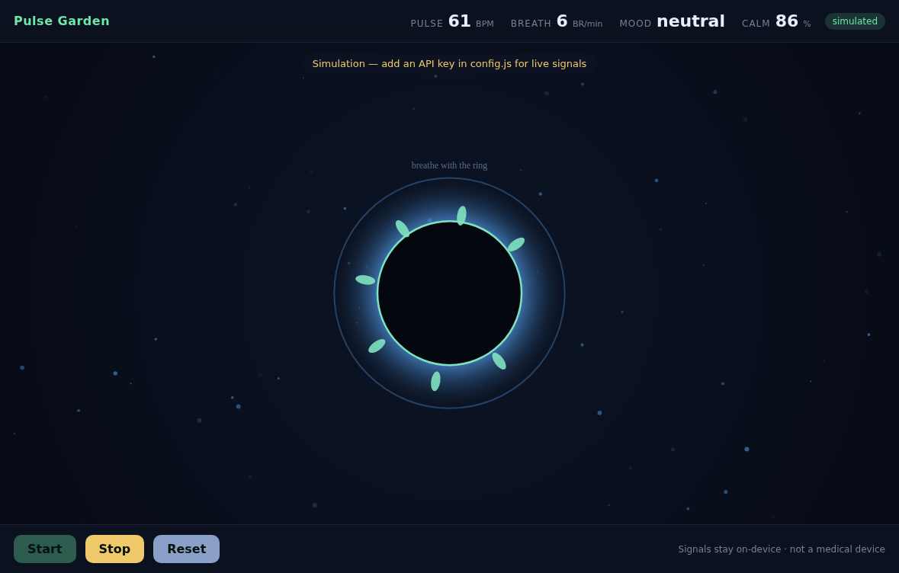

# Pulse Garden 🌱

A calm-breathing desktop companion for the **[Presage SmartSpectra SDK Challenge](https://dev.to/challenges/presage-2026-11-04)**.



A living, glowing garden that responds to **you** in real time — captured through a standard webcam and measured **on-device** by the SmartSpectra SDK:

| Signal | What the garden does |
| --- | --- |
| **Pulse rate** | The orb beats with your heart; each beat sends an expanding ring out into the dark. |
| **Breathing rate** | A pacer ring expands and contracts with your breath. The garden breathes *with* you. |
| **Facial expression** | Your mood sets the palette — happy warms it gold-green, sad cools it deep blue, surprise sparkles violet. |
| **Calm score** | Slower, steadier breath opens more flowers. Breathe calmly and the garden blooms. |

The point: real-time biofeedback you can *see*. Nothing to read, nothing to interpret — you slow your breath, and the garden rewards you by coming alive.

> ⚠️ General-wellness / relaxation only. Not a medical device. No diagnosis, treatment, or medical decision-making.

---

## Consent & data handling

- **Camera** is used only while a session is running, with an explicit in-app consent gate before any access.
- **All signal processing is on-device.** Pulse, breathing and expression are computed locally by the SmartSpectra SDK. Raw video and all metric values stay on your machine — they are never uploaded.
- **Telemetry** (the SDK's aggregate per-session diagnostic) is **off-able** right in the consent screen. When enabled it carries only build/platform/counts — **no video, no metric values, no identifiers** (see [SDK Telemetry & Privacy](https://smartspectra.presagetech.com/docs/telemetry-and-privacy)).
- **Storage:** Pulse Garden stores nothing. No account, no cloud, no history. Close it and the session is gone.

---

## Setup

Requirements: **Node.js >= 20** (Node 24 LTS recommended), **glibc >= 2.35** (Ubuntu 22.04+ / Debian 12+) on Linux.

```bash
# 1. install deps (pulls the per-platform SmartSpectra native runtime)
npm install

# 2. add your Presage API key (free at https://physiology.presagetech.com/auth/register)
cp config.example.js config.js
#   then edit config.js and paste your key

# 3. run
npm start
```

No API key? The app starts in a clearly-labelled **simulation** mode so you can explore the UX. Live signals require a key.

### Platform notes
- Supported: `darwin-arm64`, `linux-x64`, `linux-arm64`, `win32-x64`.
- Linux needs a camera visible to the app (e.g. a webcam or `/dev/video*`). The app prompts the OS for camera permission.

---

## Architecture

```
renderer.js  →  @smartspectra/node-sdk/renderer  (SmartSpectraSDK, MediaStream input)
             →  @smartspectra/node-sdk/messages   (decodeMetrics)
             →  garden-logic.js (pure)            (expression→palette, calm score, bloom)
main.js      →  @smartspectra/node-sdk/main      (bindSmartSpectraIpc)
             →  @smartspectra/node-sdk/preload   (contextBridge)
```

Metrics requested: `breathingMetrics + cardioMetrics + faceMetrics`
(chest/abdomen breathing + breathing rate · pulse rate, arterial-pressure trace, HRV · landmarks, blinking, talking, expressions).

## Test

The pure logic has an offline self-check (no SDK / camera / network):

```bash
node test_logic.cjs
```

## License

MIT. SmartSpectra SDK is © Presage Technologies, used under its own license.
